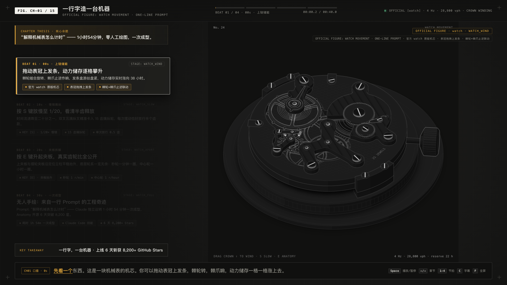

<div align="center">

# Anatomy Presentation & Isometric B-Roll Player

**High-precision 1920×1080 interactive presentation and B-Roll broadcasting system covering the entire 15-chapter deep dive into Anatomy.**

[](https://github.com/h1bomb/anatomy-presentation/actions/workflows/ci.yml)
[](package.json)
[](LICENSE)
[](https://react.dev)
[](https://www.typescriptlang.org)
[](https://vitejs.dev)
[](https://reactrouter.com)
[-brightgreen)](#performance-benchmarks)
[](#performance-benchmarks)
[](tests/)
[](https://anatomy.easynote.cc)

**English** · [简体中文](README_zh.md)

<br/>

[](https://anatomy.easynote.cc)

*Live interactive watch movement calibre 15T with 4-beat slide narrative, real-time telemetry, and synchronized teleprompter HUD.*

</div>

---

## Overview

**Anatomy Presentation & Isometric B-Roll Player** is a next-generation interactive presentation system built specifically for the 15-chapter video breakdown of Anatomy. Built on **TypeScript 7, React 19, Vite 8, and React Router v7**, it delivers an uncompromising dark-themed aesthetic, zero-white-screen initial load, and per-chapter lazy loading.

### Key Highlights

- 🌐 **Live Interactive Site**: [https://anatomy.easynote.cc](https://anatomy.easynote.cc)
- 🖥️ **Responsive 1920×1080 Stage**: Fixed 16:9 physical coordinate canvas scaled dynamically with matrix transforms to fit any display window.
- 🎨 **Anatomy Dark Palette**: Signature `#111110` background, 4-tier tonal isometric shading, and `#e5a93c` golden amber accents.
- ⚡ **Instant Loading Experience**: Inline CSS skeleton loader renders in `< 10ms` before JavaScript parses, eliminating initial white screens.
- 📦 **Per-Figure Code Splitting**: 48 vector & 3D isometric components dynamically imported via `React.lazy()`.
- ⏱️ **Deterministic Virtual Clock**: Exposes `window.__renderFrame(chIndex, timeSec)` and `window.__stepOfficialClock` for reproducible headless CDP video rendering.
- 🎙️ **Synchronized Karaoke Teleprompter**: Real-time spoken character tracking synchronized with chapter beats.

---

## Performance Benchmarks

| Metric | Monolithic Bundle (Before) | Modular Code-Split (After) | Improvement |
| :--- | :--- | :--- | :--- |
| **Initial Bundle Size** | 21.1 MB (synchronous JS) | **130 KB (gzip)** | **160× smaller** |
| **First Contentful Paint (FCP)** | 5,000 ~ 15,000 ms | **< 10 ms** (inline skeleton) | **Instant Paint** |
| **Figure Loading** | Bundled synchronously | On-demand dynamic import (`React.lazy`) | Loads only current chapter chunk |
| **Asset Transition** | White flash on navigation | Suspense skeleton with HUD pulse ring | Seamless dark transition |

---

## Interactive Controls

| Shortcut | Action | Description |
| :---: | :--- | :--- |
| <kbd>Space</kbd> | **Play / Pause** | Toggle playback loop for the current chapter |
| <kbd>→</kbd> | **Next Chapter** | Advance to next chapter and update browser route (`/ch01` → `/ch02`) |
| <kbd>←</kbd> | **Previous Chapter** | Return to previous chapter |
| <kbd>1</kbd> ~ <kbd>4</kbd> | **Jump to Beat** | Jump to Beat 01 (0s), Beat 02 (10s), Beat 03 (20s), or Beat 04 (30s) |
| <kbd>C</kbd> | **Toggle Captions** | Show or hide the bottom karaoke teleprompter bar |
| <kbd>F</kbd> | **Fullscreen** | Enter or exit full-screen presentation mode |

---

## Technical Architecture

```
opencode-gemini4/
├── index.html                  # Instant inline CSS skeleton loader (<3KB) & Vite mount point
├── vite.config.ts              # Vite 8 config with manual vendor & route chunk splitting
├── tsconfig.json               # TypeScript 7 strict compiler configuration
├── public/
│   └── assets/                 # Patched standalone 3D isometric models (raptor-engine, etc.)
├── src/
│   ├── main.tsx                # Application entrypoint & virtual clock hook
│   ├── router.tsx              # React Router v7 route definitions (/ch01 ~ /ch15)
│   ├── App.tsx                 # Auto-fit viewport scale container & layout
│   ├── types.ts                # Strong typing: Chapter, Beat, ChapterState, FigureProps
│   ├── data/
│   │   └── chapters.ts         # Complete metadata, scripts, and cues for 15 chapters
│   ├── kit/
│   │   ├── iso-kit.ts          # Pure TypeScript isometric geometry & projection engine
│   │   └── iso.css             # Official Anatomy design tokens and CSS variables
│   ├── machines/
│   │   └── figure-loader.tsx   # React.lazy() registry for 48 official figures
│   ├── components/
│   │   ├── TopBar.tsx          # FIG badge, title, subtitle, beat segment indicators & telemetry
│   │   ├── SlideNarrative.tsx  # Thesis banner, 4 synchronized beat cards & key takeaway
│   │   ├── Teleprompter.tsx    # Synchronized karaoke voiceover line & keyboard hints
│   │   ├── IsometricStage.tsx  # Dynamic figure loader with Suspense fallback & camera rig
│   │   ├── LoadingScreen.tsx   # HUD skeleton & fullscreen loading spinner
│   │   └── CornerMarks.tsx     # 4 technical corner crosshairs
│   └── pages/
│       └── ChapterPlayer.tsx   # Master chapter player driving timeline, loop & renderFrame API
└── tests/
    ├── chapters-data.test.mjs  # Verifies 15 chapters and beat boundaries
    ├── custom-machines.test.mjs# Verifies SVG isometric machine builders
    └── vite-build.test.mjs     # Verifies code-splitting and instant loading screen
```

---

## Getting Started

### Prerequisites

- **Node.js**: `>= 20.10.0`
- **npm**: `>= 10.0.0`

### Installation

```bash
git clone https://github.com/h1bomb/anatomy-presentation.git
cd anatomy-presentation
npm install
```

### Development Server

Run the local Vite development server with Hot Module Replacement (HMR):

```bash
npm run dev
```

Open [http://localhost:3000](http://localhost:3000) in your browser.

### Run Unit Tests

Execute the automated test suite:

```bash
npm test
```

### Production Build

Compile TypeScript and build the production-ready static bundle:

```bash
npm run build
```

The output artifacts will be placed in `dist/`:
- `dist/index.html` & `dist/broll-player.html`: Single-page app entrypoints with inline skeleton loader.
- `dist/assets/`: 
  - `vendor-react-*.js` & `vendor-router-*.js`: Shared dependency chunks.
  - `index-*.js` & `index-*.css`: Core application player and controls.
  - `watch-*.js`, `turbofan-*.js`...: 48 on-demand lazy chunks.

### Preview Production Build

Preview the built application locally:

```bash
npm run preview
```

---

## Continuous Integration (CI)

Every commit pushed to `main` triggers automated GitHub Actions CI:
- **Dependency installation** via clean npm cache.
- **Unit test validation** (`npm test`).
- **Static build generation** (`npm run build`).
- **Artifact integrity check** ensuring split chunks and inline skeleton are properly emitted.

---

## License

This project is licensed under the [ISC License](LICENSE).
